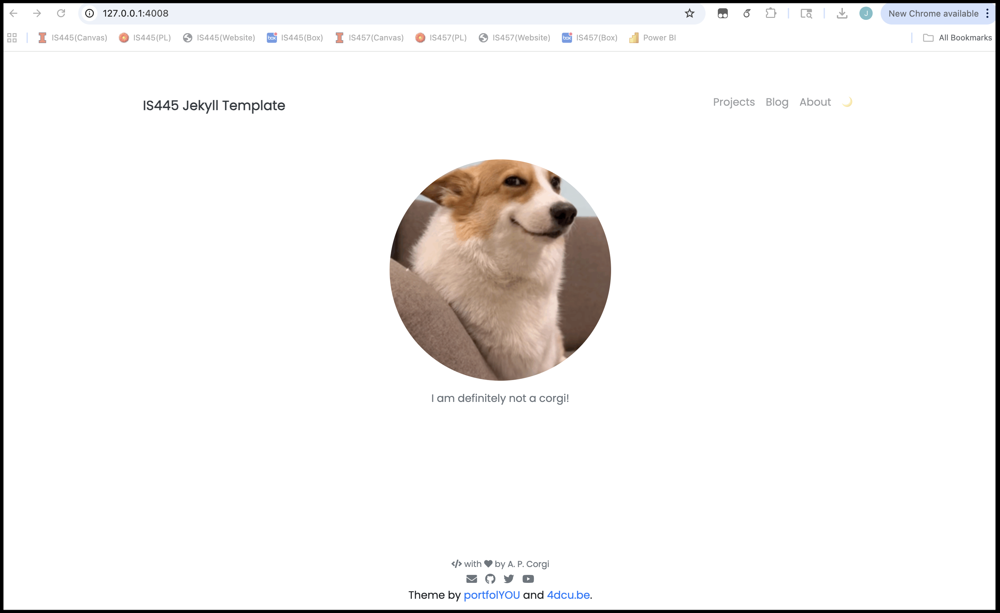
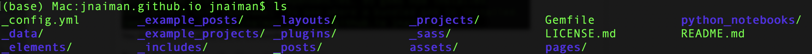
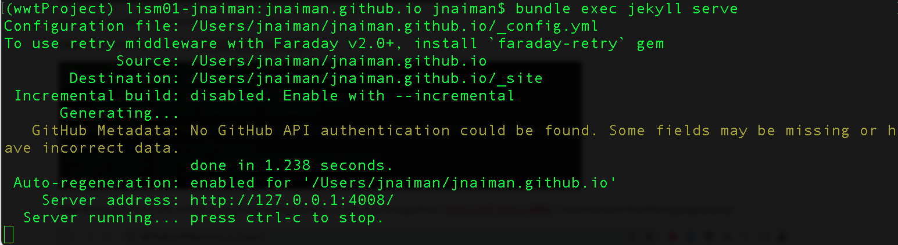
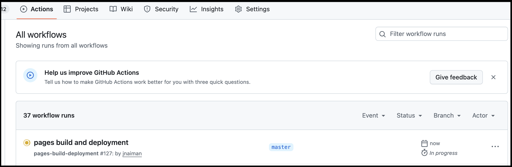
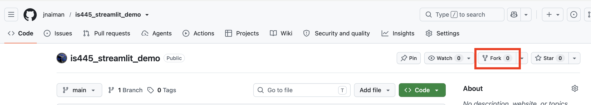
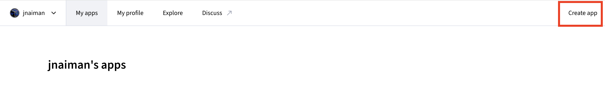
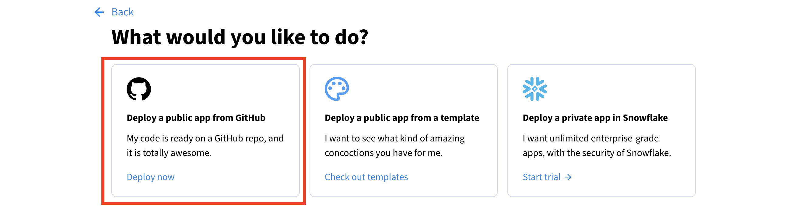
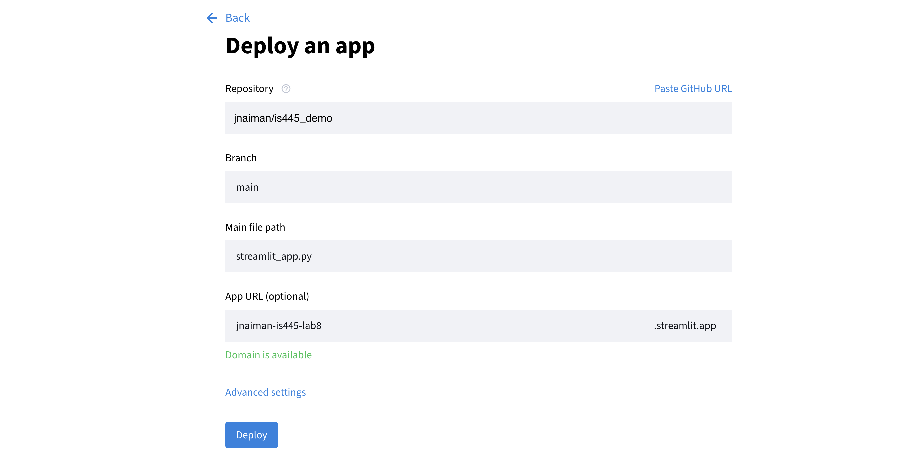
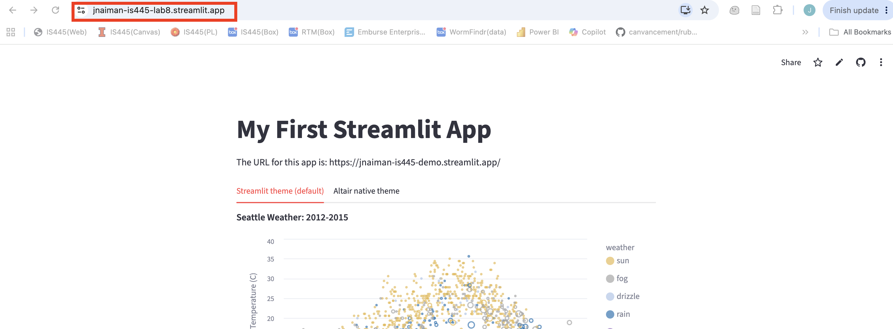

<br/><br/><br/>
# Setup Part 2: Your Website & Your App

notes:
now that we have accounts (and maybe some installs) let's get our two "homes on the web" set up

we'll fill them with content in Modules 3 and 4

---

## Part A: Your github.io website

[GitHub Pages](https://pages.github.com/) hosts a website for free from a GitHub repository named:

### `<your-username>.github.io`

notes:
the name is very specific!  it has to be exactly your username plus .github.io, all lowercase

---

## The template

We'll start from an [online CV template](CV_TEMPLATE) with interactive plots built in.



notes:
it has an About page (skills + timeline), a Projects page (where our plots will go) and an optional blog

the screenshot says IS445 -- this is the same template that course uses

---

## A1. Create the repository

1. GitHub → **+** → **New repository**
2. Name: **`<your-username>.github.io`**
3. **Public**
4. Track B: tick "Add a README file"
5. **Create repository**

notes:
**demo this live**

---

## A2. Download the template

[⬇️ Download the template zip](CV_TEMPLATE_ZIP), then unzip it.

Copy **everything inside** `online_cv_public_fa2026-main` (not the folder itself) into your repository.

notes:
the most common mistake: uploading the whole folder, so your site lives at github.io/online_cv_public_fa2026-main -- we want the files at the top level

---

## A3 (Track A): Clone, copy, preview

```bash
git clone https://github.com/<you>/<you>.github.io.git
```



notes:
copy the template's contents into the cloned folder -- it should look roughly like this (exact files may differ a bit)

---

## A3 (Track A): Clone, copy, preview

```bash
cd <you>.github.io
bundle install
bundle exec jekyll serve
```



Open [http://localhost:4008](http://localhost:4008)

notes:
bundle install only the first time (installs the site's ruby packages)

if it errors -- check the troubleshooting section, most fixes are "delete Gemfile.lock and bundle install again"

---

## A3 (Track A): Push it to GitHub

```bash
git add -A
git commit -m "add Jekyll template"
git push
```

notes:
CTRL+C to stop the server first (or open a second terminal)

first push will ask you to log in

---

## A3 (Track B): Upload in the browser

**Add file → Upload files**, drag in the contents of the template folder.

GitHub accepts **100 files per upload**, so do **two batches**:
1. the folders starting with `_` → **Commit changes**
2. everything else → **Commit changes**

notes:
**demo this live** -- the "_" folders first is just a convenient way to split it in two

hidden files like .gitignore may not upload -- that's fine

---

## A4. Turn on GitHub Pages (everyone)

**Settings → Pages** → "Deploy from a branch", `main`, `/ (root)` → **Save**

Then watch the **Actions** tab:



notes:
yellow = building, green = done, red = error (click it to see why)

then go to https://<you>.github.io -- should look like the local preview

---

## A5. Make it yours

Edit `_config.yml` ("PART 1" at the top):

```yaml
title               : Your Name -- Portfolio
repository          : your-github-username
author:
  name              : Your Name
```

* **Track A:** edit, restart `jekyll serve`, check, then `git add -A` / `commit` / `push`
* **Track B:** click the file on GitHub → ✏️ → edit → **Commit changes**

notes:
changes to _config.yml need a restart of jekyll serve -- every other file updates on its own

more on all the template's files in Module 3 (and in the template's README)

---

## Option: a different repository

Already using `<you>.github.io`? Put the template in **any** public repo (e.g. `webviz_portfolio`):

1. `_config.yml`: `baseurl: "/webviz_portfolio"`
2. Turn on Pages (same as A4)

Site: `https://<you>.github.io/webviz_portfolio`

notes:
this is also how this workshop's own site works -- baseurl is the repo name

---

## Part B: Your Streamlit app

An app needs just **two files** in a **public GitHub repository**:

* `streamlit_app.py` -- your Python code
* `requirements.txt` -- the packages to install (`streamlit`, `altair`, ...)

notes:
streamlit community cloud reads these from github and runs the app for you

---

## B1. Get the starter files on GitHub

Pick one:
* **Fork** the [starter repo](STREAMLIT_TEMPLATE) (easiest)
* **Upload** the [workshop's starter files](COURSE_GITHUB/tree/main/module04/streamlit_starter) to a new repo (Add file → Upload files)
* Put them in a **folder** of any public repo you already have

---

## B1. Forking



notes:
fork = your own copy of somebody else's repository

---

## B1. Forking


Give it a name like `webviz_streamlit` → **Create fork**

notes:
screenshot shows the IS445 name -- name yours whatever you like

---

## B2. Deploy on Streamlit Community Cloud

[share.streamlit.io](https://share.streamlit.io/) → **Create app**



---

## B2. Deploy on Streamlit Community Cloud

**"Deploy a public app from GitHub"**



---

## B2. Deploy on Streamlit Community Cloud



Repository, branch `main`, main file `streamlit_app.py` (or `folder/streamlit_app.py`), and an App URL → **Deploy**

notes:
first build takes a few minutes

---

## B2. Your app is live!



notes:
share the URL with a neighbor!

---

## B3. Make an edit

* **Track B:** on GitHub, open `streamlit_app.py` → ✏️ → change `st.title(...)` → **Commit changes** → refresh the app

* **Track A:**

```bash
git clone https://github.com/<you>/webviz_streamlit.git
cd webviz_streamlit
conda activate webviz
streamlit run streamlit_app.py
```

notes:
track A: a browser tab opens at localhost:8501 -- edit, save, click "Rerun" (or "Always rerun"), then git add/commit/push when happy

Streamlit Cloud rebuilds automatically every time the repo changes

---

## Checklist

- [ ] `https://<you>.github.io` shows the template with your name
- [ ] `https://<your-app>.streamlit.app` shows the starter app
- [ ] (Track A) `jekyll serve` and `streamlit run` both work on your computer

notes:
if all three (or two for Track B) work, we're ready for Modules 3 & 4!

**pause for questions / help**
