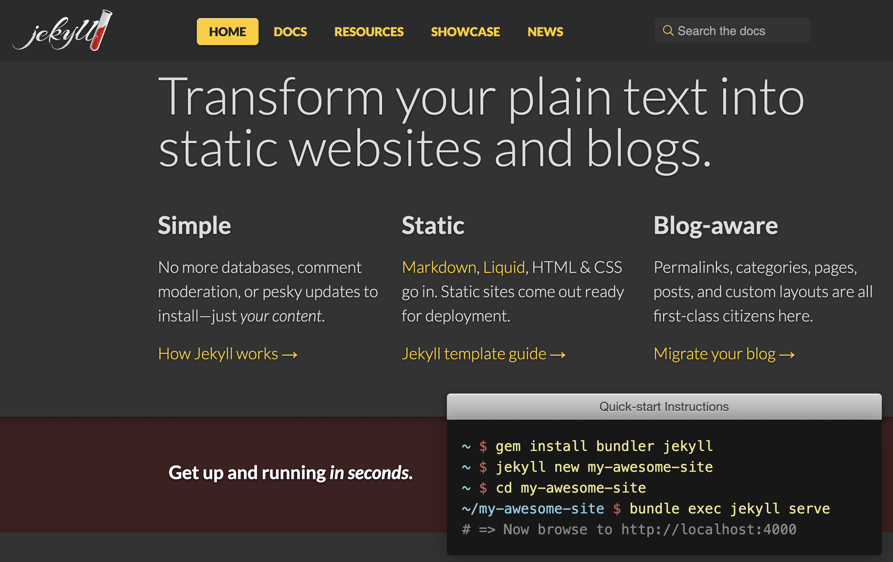
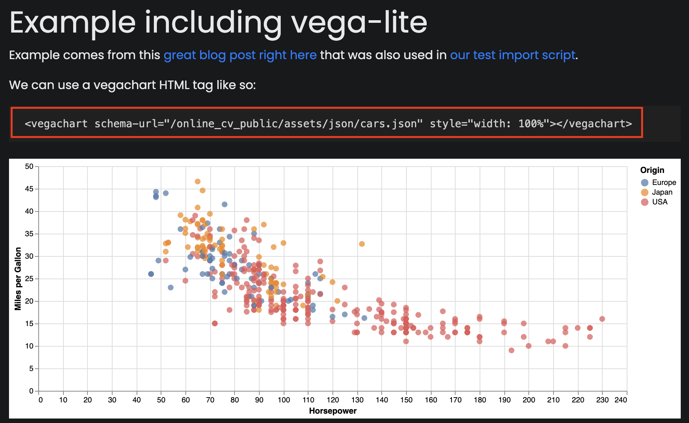

<br/><br/><br/>
# Altair Plots on Your Jekyll Site

notes:
we have JSON files -- now let's get them onto our github.io site

---

## Jekyll: a static site generator

<div class="left">

[Jekyll](https://jekyllrb.com/) turns **Markdown** text files + **templates** into a website.

* You write content in Markdown (like Jupyter text cells)
* The template handles the look (HTML, CSS, JavaScript)
* GitHub Pages runs Jekyll for you every time you push/upload

</div>
<div class="right">

</div>

notes:
"static" = the site is built once into plain files, there's no server running code when someone visits -- that's why it can be hosted for free

this workshop's website is a Jekyll site too!

---

## Three little languages

* **Markdown** -- the text: `**bold**`, `_italics_`, `[link](url)`, `# Heading`
* **YAML** -- settings: `title: My Site` (in `_config.yml` and at the top of pages)
* **Liquid** -- template code in curly braces, e.g. `{{ site.baseurl }}`

You'll mostly write Markdown. The template handles the rest.

notes:
you'll see a little YAML and a tiny bit of Liquid -- you don't need to learn them beyond copying the patterns we'll use

---

## Front matter

The YAML between `---` lines at the top of a page:

```yaml
---
title: Interactive Plots with Altair
tools: [Python, Altair, vega-lite]
image: my_assets/pngs/altair_workshop_card.png
description: Four interactive plots made in Python with Altair.
---

# My page starts here, in Markdown
```

notes:
front matter = settings for one page. YAML is picky: a space after each colon, and consistent indentation

---

## The template's files

```
<you>.github.io/
├── _config.yml        <- site settings (title, your name, links)
├── about_me/          <- About page text, skills, timeline
├── projects/          <- ONE .md FILE PER PROJECT PAGE  ★
├── my_assets/
│   ├── json/          <- your Altair/vega-lite .json files ★
│   └── pngs/          <- images
└── _template/         <- the machinery (don't need to touch)
```

More in the [template README](CV_TEMPLATE#readme).

notes:
★ = the two folders we'll use today

**open the template README and scroll through section 4**

---

## The example project



`projects/1_Vega_lite_project.md` → the Projects page on your site

notes:
**open your own github.io/projects page and click the example**

---

## How a plot gets on a page

**1.** In the front matter, load the plotting code (**required!**):

```yaml
custom_js:
  - vega.min
  - vega-lite.min
  - vega-embed.min
  - justcharts
```

**2.** In the page, one line per plot:

```html
<vegachart schema-url="{{ site.baseurl }}/my_assets/json/my_plot.json" style="width: 100%"></vegachart>
```

notes:
forgetting custom_js is the #1 reason a plot doesn't show up -- the page will just have a blank space

{{ site.baseurl }} is Liquid: it fills in "" for a <you>.github.io site, or "/repo-name" if you host in another repo, so the same line works in both places

---

## Workflow

1. Make plot in Python → `chart.save("my_plot.json")`
2. Put `my_plot.json` in `my_assets/json/`
3. Add a `<vegachart>` line to a page in `projects/`
4. Push / upload → GitHub rebuilds your site

notes:
that's it! everything else is writing text around your plots

---

## Hands-on: the starter files

[module03/jekyll_starter](COURSE_GITHUB/tree/main/module03/jekyll_starter) mirrors the template's folders:

| Starter file | → goes in your repo at |
|---|---|
| `projects/2_my_altair_plots.md` | `projects/` |
| `my_assets/json/*.json` (4 files) | `my_assets/json/` |
| `my_assets/pngs/altair_workshop_card.png` | `my_assets/pngs/` |

Use **your own** JSONs from the notebook, or the ready-made ones.

notes:
the ready-made JSONs are exactly what the notebook saves -- so if your notebook had trouble, you can still do this part

---

## Track B: upload in the browser

1. Download each starter file (open it on GitHub → ⬇️ "Download raw file")
2. In **your** repo, click into `my_assets/json` → **Add file → Upload files** → drag in the JSONs → **Commit changes**
3. Same for `my_assets/pngs` and `projects`
4. Watch the **Actions** tab, then visit `https://<you>.github.io/projects/`

notes:
**demo this live**

uploading a file with the same name replaces the old one -- so updating a plot = re-save in Python, re-upload

---

## Track A: copy, preview, push

Copy the files into your local clone, then:

```bash
bundle exec jekyll serve      # check http://localhost:4008/projects/
git add -A
git commit -m "add Altair project"
git push
```

notes:
you can leave jekyll serve running while you edit -- refresh the browser to see changes (except _config.yml)

---

## Make it yours

Open `projects/2_my_altair_plots.md` (✏️ on GitHub, or your editor):

* change the `title:` and `description:`
* rewrite the text: what should a reader notice? (Module 2!)
* delete a plot you don't want, or swap in your own `.json`
* new project? copy the file to `3_something.md`

notes:
file names start with numbers to set the order on the Projects page

---

## Not using the template?

The JSON files work on **any** website:

* [any_site_starter/plot_page.html](COURSE_GITHUB/blob/main/module03/any_site_starter/plot_page.html) -- a plain HTML page that loads `.json` plots ([see it live](COURSE_WEBPAGE/module03/any_site_starter/plot_page.html))
* `chart.save("my_plot.html")` -- Altair writes a whole page for you ([example](COURSE_WEBPAGE/module03/any_site_starter/standalone_from_altair.html))

Upload either to **any** GitHub repo with Pages turned on.

notes:
the trick in plot_page.html is three script tags (vega, vega-lite, vega-embed) and one vegaEmbed("#div", "file.json") call per plot

that's also what the template's "justcharts" does under the hood

---

## Debugging checklist

Plot not showing?
1. `custom_js` lines in the front matter?
2. JSON file name/folder exactly right? (capital letters matter!)
3. `{{ site.baseurl }}` at the start of `schema-url`?
4. Did the build finish? (Actions tab green)
5. Still blank? Open the browser console (right click → Inspect → Console) and look for red errors

notes:
also try the browser's developer console (right click → Inspect → Console) -- a red "404" means the JSON path is wrong
