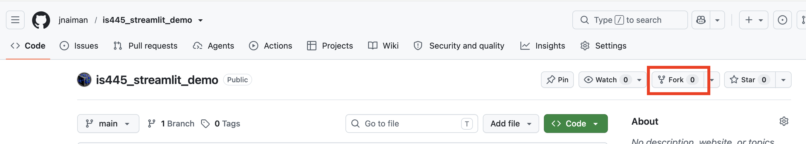
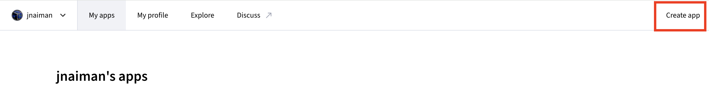
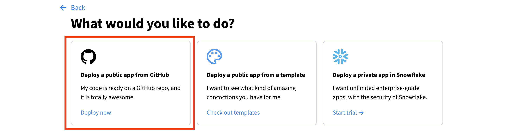
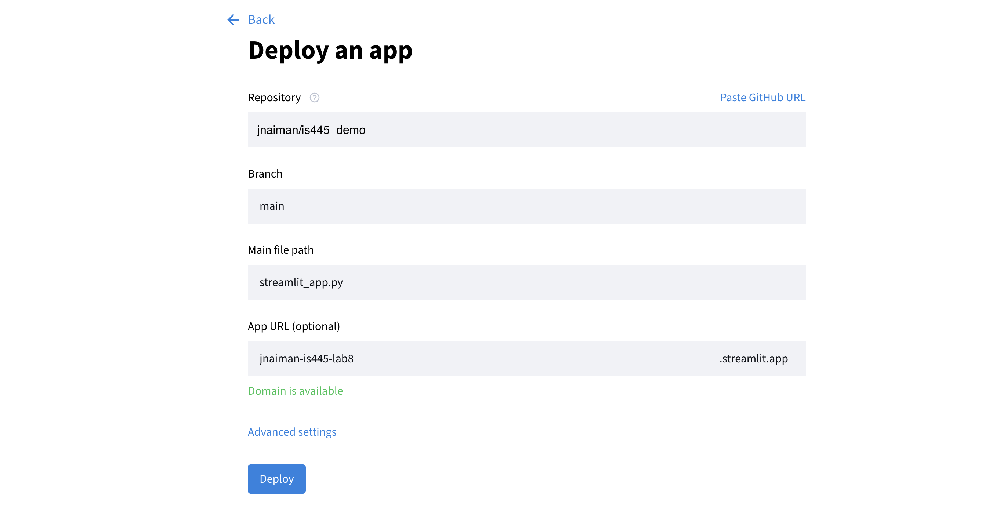
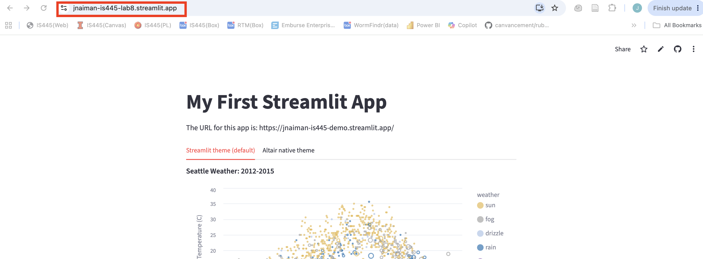

   
# Your First Streamlit App

notes:
modules 1-3 gave us a finished website.  now a second, separate tool: an "app" where Python runs when people use it

everything we need for this module is set up right here -- all you need is your GitHub account

---

## Where we are going

A **web app** at `https://<your-app>.streamlit.app` that anyone can use:

* [Streamlit](https://streamlit.io/) turns a Python script into a web app
* [Streamlit Community Cloud](https://share.streamlit.io/) runs it for free

notes:
today: get a first app online (this lecture), learn how to build one (4.2), then put our own app online (4.3)

---

## An app is two files

In a **public GitHub repository**:

* `streamlit_app.py` -- your Python code
* `requirements.txt` -- the packages to install (`streamlit`, `altair`, ...)

notes:
streamlit community cloud reads these from github and runs the app for you

---

## 1. Make a Streamlit account

[share.streamlit.io](https://share.streamlit.io/) → **"Continue with GitHub"**

notes:
streamlit cloud reads your GitHub repositories to build apps, so we link the two accounts -- click "Authorize" when GitHub asks

---

## 2. Get the starter files on GitHub

Pick one:
* **Fork** the [starter repo](STREAMLIT_TEMPLATE) (easiest)
* **Upload** the [workshop's starter files](COURSE_GITHUB/tree/main/module04/streamlit_starter) to a new public repo (Add file → Upload files)
* Put them in a **folder** of any public repo you already have

---

## 2. Forking

notes:
fork = your own copy of somebody else's repository

---

## 2. Forking

Give it a name like `webviz_streamlit` → **Create fork**

notes:
screenshot shows the IS445 name -- name yours whatever you like

---

## 3. Deploy on Streamlit Community Cloud

[share.streamlit.io](https://share.streamlit.io/) → **Create app**

---

## 3. Deploy on Streamlit Community Cloud

**"Deploy a public app from GitHub"**

---

## 3. Deploy on Streamlit Community Cloud

Repository, branch `main`, main file `streamlit_app.py` (or `folder/streamlit_app.py`), and an App URL → **Deploy**

notes:
first build takes a few minutes

---

## Your app is live!

notes:
share the URL with a neighbor!

---

## 4. Make an edit

On GitHub: open `streamlit_app.py` → ✏️ → change the text in `st.title(...)` → **Commit changes** → refresh your app

Streamlit Cloud rebuilds the app **every time the repository changes**.

notes:
this is the edit loop for the rest of the module: edit on GitHub, commit, refresh the app

---

## Checklist

- [ ] `https://<your-app>.streamlit.app` shows the starter app
- [ ] Your edit to `st.title(...)` shows up

Want to run apps on your own computer instead? That's [Module 6](COURSE_WEBPAGE/module06/) -- optional, and not needed today.

notes:
next: how a streamlit app actually works

**pause for questions / help**
