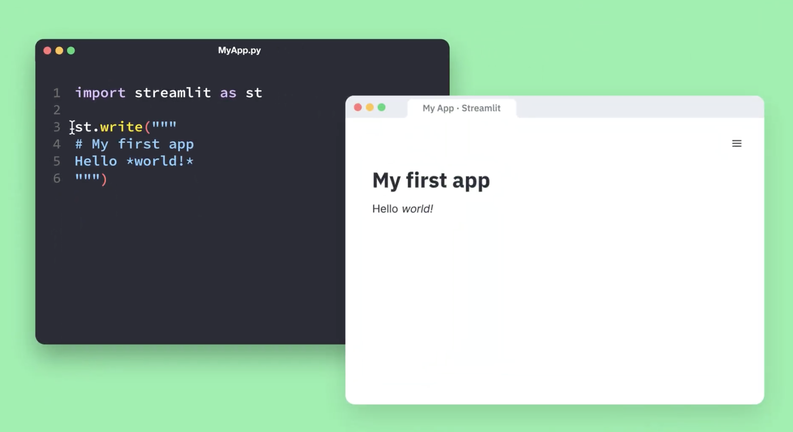

<br/><br/><br/>
# Building Apps with Streamlit

notes:
the website from modules 1-3: plots on a static site.  a streamlit app: Python actually runs when people use it

---

## Jekyll site vs. Streamlit app

| | Jekyll + Altair JSON | Streamlit app |
|---|---|---|
| What runs when someone visits? | Nothing -- just files | Your Python script |
| Interactivity | What vega-lite can do in the browser | Anything Python can do |
| Hosting | GitHub Pages | Streamlit Community Cloud |
| Speed | Instant | Can "go to sleep", takes a moment to wake |
| Good for | Portfolios, write-ups, a few plots | Dashboards, data tools, filtering big data |

notes:
neither is "better" -- they're good at different things, and you can link them together (Module 5)

free streamlit apps go to sleep if nobody visits for a while -- the first visitor clicks a button to wake it up

---

## Streamlit

[Streamlit](https://streamlit.io/) turns a Python script into a web app:



notes:
each st.something call adds a piece to the page, top to bottom

---

## The big idea

**Streamlit re-runs your whole script, top to bottom, every time a viewer touches a widget.**

```python
import streamlit as st

name = st.text_input("Your name")
st.write("Hello", name)
```

notes:
no callbacks or event handlers to learn (for basic apps) -- a widget just returns a value, like a normal variable

this is also why we use @st.cache_data for loading data -- otherwise it re-downloads on every click

---

## Text

```python
st.title("My app")
st.header("A section")
st.markdown("Some **bold** text and a [link](https://streamlit.io)")
st.write(df)      # write() figures out how to show almost anything
```

[Text docs](https://docs.streamlit.io/develop/api-reference/text)

---

## Widgets

```python
states = st.multiselect("States", all_states, default=["IL"])
low, high = st.slider("Income", 15000, 60000, (20000, 40000))
urban = st.checkbox("Urban only")
color_by = st.radio("Color by", ["State", "Urban"])
```

Each one returns its current value → use it in pandas:

```python
filtered = df[df["State"].isin(states) & df["Income"].between(low, high)]
```

[Widget docs](https://docs.streamlit.io/develop/api-reference/widgets)

notes:
this is the main pattern for an interactive Streamlit app: widgets → filter data with pandas → plot

---

## Altair plots in Streamlit

Any Altair chart (like the ones from Module 3), then:

```python
chart = alt.Chart(filtered).mark_circle().encode(
    x="Income:Q", y="Mobility:Q", color="State:N", tooltip=["Name"]
).interactive()

st.altair_chart(chart)
```

Already have a plot saved as a `.json` file?

```python
st.vega_lite_chart(json.load(open("corgis_over_time.json")))
```

notes:
so the work from module 3 carries straight over -- and if you skipped module 3, the starter app already has a .json plot in it

---

## Selections back to Python

```python
brush = alt.selection_interval(name="brush")
chart = alt.Chart(df).mark_circle().encode(...).add_params(brush)

event = st.altair_chart(chart, on_select="rerun")
event.selection["brush"]    # e.g. {"Income": [20000, 35000], "Mobility": [0.1, 0.2]}
```

Drag a box → Python gets the ranges → filter a table, compute stats, ...

notes:
this is something a plain Jekyll page can't do -- the selection goes back into Python code

---

## Layout

```python
st.sidebar.slider(...)                    # put widgets in a sidebar
tab1, tab2 = st.tabs(["Plot", "Data"])    # tabs
left, right = st.columns(2)               # side-by-side columns

with tab1:
    st.altair_chart(chart)
```

[Layout docs](https://docs.streamlit.io/develop/api-reference/layout)

---

## Hands-on: the starter app

[module04/streamlit_starter/streamlit_app.py](COURSE_GITHUB/blob/main/module04/streamlit_starter/streamlit_app.py)

* sidebar widgets → pandas filter
* an Altair scatter plot
* a box selection sent back to Python
* a JSON plot from Module 3
* a data table with a download button

notes:
**open the file and walk through each numbered section**

Lecture 4.3: getting it online

---

## Try it yourself

* change the title and write-up text
* add a widget (try `st.selectbox` or `st.select_slider`)
* plot a different column -- e.g. `Student_teacher_ratio`
* add a second dataset: [corgis](https://raw.githubusercontent.com/UIUC-iSchool-DataViz/is445_data/main/corgs_per_country_over_time_columns_2020.csv)?

Ideas: [Streamlit gallery](https://streamlit.io/gallery)

notes:
remember Module 2 -- who is the app for, and what should they take away?
