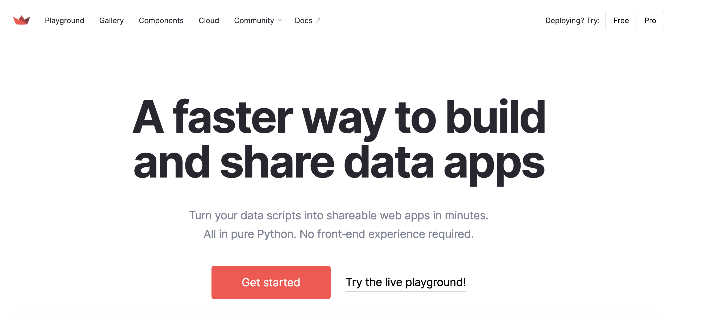
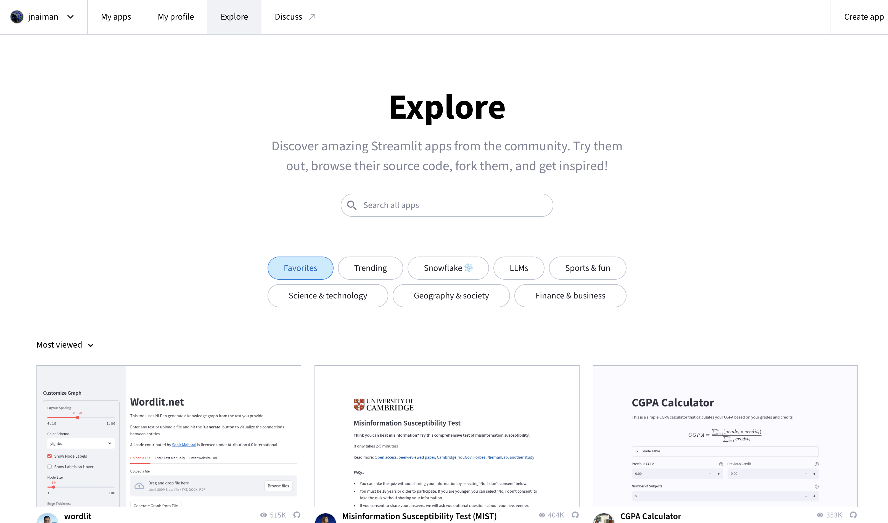

<br/><br/><br/>
# Hosting on Streamlit Community Cloud

notes:
we deployed the starter repo in Module 1 -- now let's put OUR app there and learn the edit → update loop

---

## Streamlit Community Cloud

[share.streamlit.io](https://share.streamlit.io/) runs your app for free from a **public GitHub repository**.



notes:
free for public apps -- your code AND your app are public, so don't put private data in them

---

## What it needs

A **public GitHub repo** (or a folder in one) with:

```
streamlit_app.py      <- your app
requirements.txt      <- one package per line
(any data / .json files your app reads)
```

```
streamlit
altair>=6,<7
pandas
```

notes:
requirements.txt is how Streamlit Cloud knows what to install -- forget a package and you get ModuleNotFoundError

---

## Option 1: upload in the browser

1. Download the [starter files](COURSE_GITHUB/tree/main/module04/streamlit_starter) (⬇️ "Download raw file" on each)
2. Your Module 1 repo (or a new **public** one) → **Add file → Upload files** → **Commit changes**
   * uploading `streamlit_app.py` **replaces** the old one
3. The app rebuilds by itself!

notes:
if you deployed the forked starter in Module 1, just upload into that same repo -- no need to create a new app

---

## Option 1: edit in the browser

On GitHub: open `streamlit_app.py` → ✏️ → edit → **Commit changes** → refresh your app

Bigger edits: press **`.`** on your repo's page to open [github.dev](https://github.dev), a VS Code editor in the browser.

notes:
github.dev can't *run* the app, but it's a much nicer editor; your live app is your "preview"

tip: keep the app open in one tab and GitHub in another

---

## Option 2: work locally, then push

```bash
git clone https://github.com/<you>/webviz_streamlit.git
cd webviz_streamlit
# copy in the starter files, then:
conda activate webviz
streamlit run streamlit_app.py      # http://localhost:8501
```

```bash
git add -A
git commit -m "my app"
git push                             # live app updates
```

notes:
much faster loop -- save, click Rerun, see the change -- and only push when it works

---

## New app or new location?

**Create app** → **Deploy a public app from GitHub**


App in a folder? Main file path = `folder/streamlit_app.py`

notes:
so the app files can live anywhere -- a dedicated repo, or a folder inside your github.io repo

you can have several apps from one repo, each pointing at a different file

---

## When things go wrong

* App shows an error → **Manage app** (bottom right) → read the logs
* `ModuleNotFoundError` → add the package to `requirements.txt`
* Works locally, not online → is every file committed? Is the data path relative to the app?
* Stuck on an old version → ⋮ menu → **Reboot app**

notes:
most errors are a missing package or a missing file

---

## Sharing your app

* The URL: `https://<your-app>.streamlit.app`
* **Settings → Sharing**: public (default) or invite specific people
* Explore others' apps: [Streamlit gallery](https://streamlit.io/gallery)



notes:
next: linking your app and your website together (Module 5)
