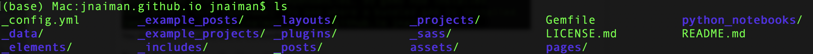
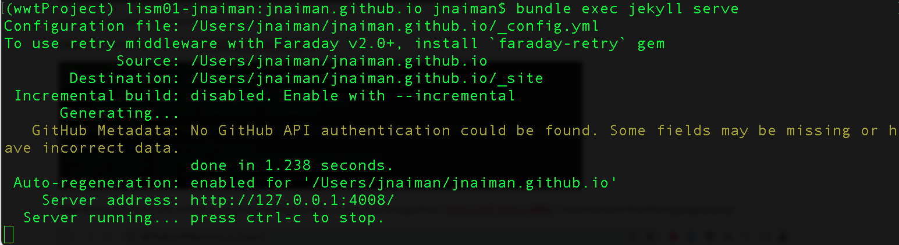

<br/><br/><br/>
# Working on Your Site & App Locally

notes:
we have the tools installed (Lecture 6.1) -- now let's use them on the website and app we built in the browser

---

## The local loop

1. `git clone` -- copy a repository to your computer (once)
2. **edit** → **preview** on your computer → repeat
3. `git add` / `git commit` / `git push` -- send it to GitHub
4. GitHub Pages / Streamlit Cloud rebuild the live version

notes:
step 2 is the fast part -- that's the whole point of installing things

---

## Part A: your github.io site

```bash
git clone https://github.com/<you>/<you>.github.io.git
cd <you>.github.io
```



notes:
these are the same files you uploaded in Module 1 -- exact files may differ a bit from the screenshot

starting from scratch? the install page has the steps (new empty repo, clone, copy in the template)

---

## Preview it

```bash
bundle install            # first time only
bundle exec jekyll serve
```



Open [http://localhost:4008](http://localhost:4008)

notes:
bundle install installs the site's ruby packages

if it errors -- check the troubleshooting section, most fixes are "delete Gemfile.lock and bundle install again"

---

## Edit → refresh

* Leave `jekyll serve` running
* Edit a file in `projects/`, save, **refresh** the browser
* `_config.yml` changes need a **restart** (`CTRL+C`, then `serve` again)

notes:
try it: change a sentence in projects/2_my_altair_plots.md and refresh

---

## Push it to GitHub

```bash
git add -A
git commit -m "describe what you changed"
git push
```

Watch the **Actions** tab → `https://<you>.github.io` updates.

notes:
CTRL+C to stop the server first (or open a second terminal)

first push will ask you to log in

---

## Altair plots, locally

1. `conda activate webviz` → `jupyter lab` → the [Module 3 notebook](COURSE_RAW/module03/altair_to_json.ipynb)
2. JSONs land in `my_json_files/` → copy them to `my_assets/json/`
3. Check at [http://localhost:4008/projects/](http://localhost:4008/projects/)
4. `git add -A` / `commit` / `push`

notes:
same notebook as Module 3, just running on your computer instead of Colab -- no zip download needed

---

## Part B: your Streamlit app

```bash
git clone https://github.com/<you>/webviz_streamlit.git
cd webviz_streamlit
conda activate webviz
streamlit run streamlit_app.py
```

Opens [http://localhost:8501](http://localhost:8501)

notes:
the repo you forked (or made) in Lecture 4.1

---

## Edit → Rerun → push

* Edit `streamlit_app.py`, save, click **Rerun** (or "Always rerun") in the app
* Happy with it? `git add -A` / `commit` / `push` → the live app rebuilds
* New package? Add it to `requirements.txt` too!

notes:
the #1 "works on my computer but not online" problem is a package installed locally but missing from requirements.txt

---

## One rule: pick one place to edit

Edited on github.com *and* on your computer? `git push` will be **rejected**.

Fix: `git pull`, then `git push`.

Habit: run `git pull` every time you sit down to work.

notes:
this is the most common git hiccup for people switching between the browser and their computer

---

## Checklist

- [ ] `bundle exec jekyll serve` shows your site at localhost:4008
- [ ] `streamlit run streamlit_app.py` shows your app at localhost:8501
- [ ] A `git push` updates the live site/app

notes:
that's it -- you can now build both tools fully on your own computer

**pause for questions**
